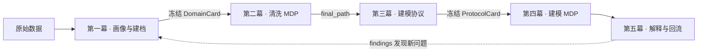

# 研究流（Research Flow）——从数据到模型的一局

> 阅读说明：**U = 用户**（领域科学家），**A = agent**（mflowy 的策略 π——环境面在引擎，决策权在你眼前的这段对话里）。工具调用以行内代码标注；`[thinking]` 是 agent 在工具调用之间的决策思考——π 的选择步骤；「幕间」是方法论点题，可跳过。本文是**案例叙事**，能力与工具签名以 MCP `tools/list` 为真源，随版本演进；方法论主张的文献依据见文末锚点。

## 科学决策总纲（五律）

对话中 agent 的每次拒绝与坚持，都来自这五条上位原则：

1. **划分先行**——测试集是一次性资源，只被最终评估触碰一次；任何由数据算出的统计量只能来自训练折。
2. **基线参照**——"好不好"是相对命题：多模型同场对比 + 领域基线，无参照系的单模型指标没有决策价值。
3. **不确定性量化**——单次评估只是一个样本；差距小于折间波动时判"无显著差异"，不强行排名。
4. **单一变更**——一次实验只改一个决策变量，其余冻结，收益才可归因。
5. **可复现**——固定种子、自动记录血缘、每步决策留日志，任何结论可被第三人重放。



三道冻结门（卡即对局规则，改卡 = 新开一局）：`DomainCard → 清洗 MDP`、`final_path → 建模 MDP`、`ProtocolCard → 建模 MDP`。任何一幕结论不成立，回退上一幕重开，而不是在当前幕硬调。

---

## 第一幕 · 画像与建档：数据为什么长这样

**U**：这是我们的酶解绿茶提取实验数据，486 行。想预测 DPPH 自由基清除率——能不能建模？

**A**：先看画像，不急着下结论。（`data_profile("dpph_extraction.csv")`）整体印象：486 行 × 12 列，目标列 `提取率_pct` 连续、右偏——回归问题的样子。但画像里有几处需要你裁决的信号：

- `乙醇浓度` 数值双峰：主体在 55–95，另有 82 行落在 0.4–0.7——像是**百分数与小数两种记法混录**；
- `温度_C` 有 13 行是 −999——典型的**哨兵值**（传感器故障的记法？）；
- `提取率_pct` 缺失 27 行，另有 3 行超过 100（118.6、104.2、121.3）——物理不可能；
- 9 行**完全重复**——双录入？；
- `溶剂类型` 有 "乙醇 / ethanol / Ethanol␣" 三个变体；
- `设备型号` 全表常量，`实验编号` 全表唯一（ID 列）。

**U**：乙醇浓度确实有两批实验，早年的师兄用小数记的。−999 是温控坏了那几天。

**A**：这正是画像回答不了的——"数据为什么长这样"只有你知道。所以下一步是建档问卷，几个必答题（`propose_questions`，证据接地出题）：

1. **目标列**是 `提取率_pct`？（是 → 任务回归）
2. `实验编号` 是 ID 列吗？删行可以，删列不行？
3. `提取率` 的合法范围是 0–100？
4. 行删除的下限——这批实验贵吗，最多容忍删掉多少？
5. `乙醇浓度` 的单位约定：以百分数为准？

**U**：都对。行保留率不能低于 90%，每组实验都花了不少工夫。

**A**：收到。再补两步证据：围绕目标的相关性（`eda`）看信号强度——`温度`、`乙醇浓度` 与提取率的单调趋势都在，`粒径_um` 的趋势发散（先记着，第五幕它会回来）；然后 dive-in 出几个深钻问题（`propose_questions` 带上 eda 证据）——画像说 `粒径` 有双峰，是目估粒径与筛分粒径两种口径混录吗？

**U**：……很可能是。早年目估，后来买了激光粒度仪。

**A**：记入档案疑点，不阻断主线。DomainCard 冻结如下——**注意，冻结即对局规则**，之后任何动作都受它约束：

```yaml
target: 提取率_pct          # 值禁改（删行允许）
id_columns: [实验编号]       # never_drop
expected_ranges: {提取率_pct: [0, 100]}
unit_hints: {乙醇浓度: "%"}
min_row_retention: 0.9      # 过激动作会被引擎拒绝
```

### 幕间 · 双源对账

画像（证据）× 你的回答（先验）**冲突即发现**：小数浓度、−999 哨兵、粒径双峰，都是两源对出来的。问卷不是记录工具，是对账工具——疑似 ≠ 确定，所以粒径只入"疑点"，不入"规则"。

---

## 第二幕 · 清洗 MDP：环境与策略分家

**U**：你打算怎么洗？

**A**：开局清洗会话（`clean_session_start(file, card, max_steps=15)`）。初始观测：质量分 0.47，缺陷清单 `pattern×85, missing×40, duplicates×9, outliers×16, constant×1`。预算 15 步——**预算是硬的，回滚不退步**，好钢要用在刀刃上。

**A**：看菜单（`clean_propose`）。引擎按证据排序给我候选，**我只做选择**：

```
① drop_duplicates        证据: duplicates×9, severity 0.9   理由: 双录入，跨折即泄漏
② strip_units/pattern    证据: pattern×85, severity 0.8     理由: 溶剂变体归并 + 浓度记法统一
③ fill_missing(温度)     证据: missing×13(温度), sev 0.6    理由: 哨兵转缺失后中位数填充
④ drop_cols(设备型号)    证据: constant×1, sev 0.3          理由: 常量列零贡献
```

**A**：[thinking] 重复行是泄漏源，证据置顶——先除毒。菜单排序是建议不是命令，但这一手我服从排序。

**A**：执行（`clean_apply`）——质量 0.47 → 0.55。每步返回 diff 摘要与更新后的缺陷清单，决策日志记下 (s, a, r, s′)；菜单随状态刷新，已了结的候选退场：

```
① strip_units/pattern    证据: pattern×85, severity 0.8
② fill_missing(温度)     证据: missing×13(温度), sev 0.6
③ drop_cols(设备型号)    证据: constant×1, sev 0.3
```

**A**：[thinking] pattern×85 证据最重，且是后续浓度判断的前置——记法不统一，离群无从谈起。

**A**：执行——溶剂变体归并、浓度小数行 ×100 对齐，0.55 → 0.68。菜单再刷新时多了一张**新面孔**：

```
① fill_missing(温度)     证据: missing×13(温度), sev 0.6
② IQR 离群(乙醇浓度)     证据: outliers×3(浓度), sev 0.5     理由: 记法统一后新暴露的高浓离群
③ drop_cols(设备型号)    证据: constant×1, sev 0.3
```

变换会掀出新的缺陷层——浓度双峰并轨之前，这 3 个离群藏在两种记法的缝里。**菜单是活的**。

**U**：等等，那 27 行缺失的提取率，你直接用均值填上呗？别删行，我心疼数据。

**A**：填不了——`clean_apply(fill_missing, {col: 提取率_pct})` 被守卫拒绝：**"动作修改了目标列的值（填充/截断禁止；行删除允许）"**。目标列是监督信号之源，填它等于用模型教模型。替代走法是删这 27 行：保留率 486→459 = 0.945，高于你的 0.9 下限，放行。（若低于下限，引擎也会拒——"动作过激"，那时我们得回头谈卡。）0.68 → 0.78。

**U**：那 3 行提取率 118% 呢？

**A**：`expected_ranges` 已经圈住它们。先 `dry_run` 预览删行动作——样本上看看会连带删掉什么，确认不误伤（预览不占步数），再真删。0.78 → 0.83。

**U**：温度那 13 个 −999，直接删了？

**A**：删 13 行太奢侈。恢复循环——[thinking] 菜单置顶是温度填充，但我先摘第二行：浓度离群不除，填充与缩放的判断都会混进噪音。**菜单是建议，顺序我做主。** 0.83 → 0.86。然后温度转缺失、中位数填充——温度与提取率的关系是渐变的，13/459 的填充不伤分布。0.86 → 0.88。

**A**：菜单上只剩常量列和边际候选了：执行常量列 +0.004，再试一步 +0.005——**平台期**。继续刷分大概率是过度清洗：数据不是越干净越好，是为建模而干净。收局（`clean_finish`）：

- 终态质量 **0.89**；
- **终局 U**：train-fold 快速学习器验证，skill = 0.84——"干净且可学"（若 skill ≤ 0，说明我删过头把信号删没了，此时应该回滚而不是收局——这是"干净但不可学"的警戒线）；
- 交付物：`final_path`（终态 parquet）+ `plan_yaml`（八步清洗计划，可入 DAG 全量重放对账）+ 全程决策日志。

**U**：如果我中途反悔某个动作呢？

**A**：每步一个 parquet 版本快照，`clean_rollback(to_version)` 可回退任意历史版本——预算不退，但坏动作可撤销。审计面上，决策日志不可篡改。

### 幕间 · 每步可审计

清洗 MDP 的分工：**环境面在引擎**（转移、守卫、预算、观测），**策略在 agent**（选哪个动作、何时回滚、何时收局）。守卫拦的是"事实不成立"（删了 ID 列、改了目标值、保留率破线），从不拦"你觉得该怎么洗"——你的领域判断经参数注入，引擎的物理约束经守卫强制。

---

## 第三幕 · 建模协议：开局前把规则谈定

**A**：进建模前，四问（`model-brief` 剧本，规则预填、你只确认）：

1. **目标**：这个模型拿来干什么？
2. **指标**：默认按任务选 R²/MAE，有偏好吗？
3. **约束**：要可解释吗？有禁用的模型族吗？
4. **外部基线**：文献或经验公式给过参照数吗？

**U**：目标是**替代三分之二的验证实验**——模型筛掉没希望的工艺组合，只做 promising 的。要可解释，组会要向导师解释每个结论。数据不到 500 行，神经网络就别上了。实验室有个经验公式，R² 大概 0.6。

**A**：ProtocolCard 冻结：`task=regression, metric=r2, cv=5, banned=[MLP], max_mini=24, max_full=1, external_baseline="经验公式 R²≈0.6"`。开局即四门校验：task↔目标 dtype、metric↔task、cv↔数据规模、预算下限——任何一门不过，fail-loud，现在改比开局后改便宜。**test 集在这一刻已被切出、封存**——此后它只被最终评估触碰一次（律一）。

---

## 第四幕 · 建模 MDP：从基线到终局

**A**：开局（`modeling_session_start(file, protocol_card, card)`），P1 基线段——先让四个可用族同场站一次起跑线（`eval_mini`，inner-CV 快评，不碰 test）：

```
board（inner CV，均值−std）:
  LGBM  0.72    XGB 0.71    CAT 0.70    RF 0.69
```

**U**：LGBM 赢了？就它了。

**A**：还不到下结论的时候——0.72 vs 0.71 的差距小于折间波动，按无显著差异处理（律三）。进 P2 结构搜索，同样看菜单（`modeling_propose`）：

```
① edit(cat: ordinal)     理由: 溶剂类型三类有序（极性序），默认编码丢了序信息
② edit(num: robust)      理由: 浓度列有极端值残影，standard 会被拖偏
③ eval_mini(未评估结构)  理由: 当前 draft × 未入板的族
④ eval_full(当前最佳)    理由: 单向门——过门前先看牌面
```

**A**：[thinking] 一次只动一个槽位（律四），先 cat：ordinal 的序（水 < 乙醇 < 甲醇）是你给的领域知识。`edit` 零成本，评估才花预算（`modeling_apply`）——LGBM 0.72 → 0.74，菜单刷新，重复的编辑候选退场。

**A**：[thinking] 再动 num 槽：robust 缩放——0.745。两轮增益 +0.02 → +0.005，递减到平台。菜单上还有编辑变体可试，但预期收益已不抵一次全量训练的价值——**收束，准备过门**。

**U**：那现在让 LGBM 全量训练？

**A**：这是**单向门**（`eval_full`）：获胜结构全量训练 + Optuna 调参，**test 集在此被唯一一次触碰**——之后不能再以任何形式回头对 test 求梯度（回退被结构性拒绝，律一的硬边界）。门很贵，过门前我把牌面亮给你：inner 证据 0.745，外部基线 0.6，过门预期显著超越基线。过吗？

**U**：过。

**A**：（`eval_full`，n_trials=10）→ P3 终局段，收局（`modeling_finish`）：

- **holdout R² = 0.76**，MAE 3.1（百分单位）；
- 对照系：经验公式 0.60 → **模型 +0.16**；四个族同场排名，LGBM 胜出可归因（同折同种子，律二/律四）；
- findings 三项体检：无过拟合信号（inner−holdout 差 5%）；无切片塌陷；**`粒径_um` 误差集中（|ρ|=0.41）**——模型的误差系统性地堆在这一列上；
- 交付物：模型 loader（mlflow run 内，`predict`/`explanation` 直接消费）+ modeling_steps_yaml（可重放）+ 记分板 + findings。

### 幕间 · test 是一次性资源

整个建模 MDP 的形状由一件事决定：**holdout 只读一次**。过程奖励全部来自 inner-CV（可恢复侧——错了下一步实验修正、可回滚）；终局读数只在收局出现。这就是为什么 P2 可以试错、P3 不可回头。

---

## 第五幕 · 解释与回流：故事没有终点

**A**：解释胜者（`explanation`，SHAP）：

- `温度` 单调推高提取率——符合 Arrhenius 直觉，方向可信；
- `乙醇浓度` 呈**峰形**（60–70% 处贡献最高）——与文献的极性匹配效应一致；
- `粒径` 贡献不小但方向发散——结合第四幕 findings 的误差集中，两处证据指向同一件事。

**U**：所以粒径那列真的有问题。

**A**：第一幕的档案疑点在这里兑现了：目估与激光粒度仪两种口径混录，模型的误差踩在这条缝上。findings 的建议是**回流清洗域**——统一粒径口径（或补记口径来源列）后重开清洗会话。这正是总图上那条从"解释"折回"建档"的虚线：**评估与解释发现新问题 → 回第一幕**，而不是在当前模型上硬调。

**U**：那这次就先到这里？

**A**：本次交付清单——

| 交付物 | 位置 | 用途 |
| --- | --- | --- |
| 终态数据 | `final_path`（parquet） | 建模数据源 / 下轮回流的输入 |
| 清洗计划 | `plan_yaml` | 可入 DAG 全量重放，审计"计划 ≡ 终态" |
| 模型 | mlflow run（loader） | `predict` / `explanation` / `inverse_optimization` 直接消费 |
| 体检报告 | findings ×3 | 过拟合 / 切片 / 误差集中（回流线索） |
| 决策日志 | 清洗 + 建模两本 | 全程 (s,a,r,s′)，任何结论可被第三人重放（律五） |

下次回流时：改卡（粒径口径入 `unit_hints` 或新增口径列）= 新开一局，历史日志仍在，审计链不断。

---

## 术语表

对话中术语的集中锚点（按出场序）；方法论主张见五律，文献依据见文末锚点。

| 术语 | 含义 |
| --- | --- |
| 建档卡（DomainCard） | 数据领域先验的冻结档案：目标列 / ID 列 / 合法值域 / 单位约定 / 保留率下限——开局即冻结，改卡 = 新开一局 |
| 协议卡（ProtocolCard） | 建模对局规则的冻结档案：任务 / 指标 / CV / 预算 / 禁用族 / 外部基线——开局即四门校验 |
| 画像 | 逐列统计摘要（dtype / 缺失 / 唯一值 / 偏度 / 高频值），`data_profile` 产出 |
| 哨兵值 | 用特殊常量（−999/9999）表示缺失或异常的记法，须转缺失再处理 |
| 双源对账 | 先验（用户回答）× 证据（画像/检测）冲突即发现的建档方法——疑似 ≠ 确定 |
| 缺陷清单 / 质量分 | 清洗会话的观测面：错误类型 × 计数，与内生质量分 Φ（规则加权） |
| 菜单 | `propose` 产出的候选动作列表（证据 + 理由 + 排序）——是建议不是边界，词表内可自由参数化 |
| dry_run | 样本上的假想转移预览：看 diff 不占步数、不落版本 |
| 守卫 | 引擎侧硬约束：never_drop 列存活、目标列值禁改（删行允许）、保留率下限——拦"事实不成立"，不拦判断 |
| 回滚 | 版本树回退到任意历史版本；预算不回补，决策日志保留（审计不可篡改） |
| 平台期 | 连续多步质量增益 ≈ 0 的信号——继续清洗大概率过度 |
| 终局 U / skill | 终态数据上 train-fold 快速学习器的相对基线提升；skill ≤ 0 = "干净但不可学"警戒线 → 回滚而非收局 |
| 清洗计划（plan_yaml） | 会话决策日志的可执行形态，可入 DAG 全量重放对账（审计/重放工件，非交接必需品） |
| board | 建模会话的记分板：结构 × inner-CV 分数（均值−std），过程证据的居所 |
| 折间波动 | CV 折间指标的离散度；模型间差距小于它时判"无显著差异" |
| 单向门（eval_full） | 全量训练 + Optuna 调参 + **test 集唯一一次触碰**；门后不可回退（no-peeking 的硬边界） |
| findings | 建模收局的三项体检：过拟合信号 / 切片塌陷 / 误差集中列（回流线索） |
| 回流 | 解释与评估发现数据问题 → 回清洗域改卡重开一局的循环——故事没有终点 |

---

## 文献锚点

| 对话中的主张 | 依据 |
| --- | --- |
| 泄漏是系统性危机（重复行跨折、test 一次性） | Kapoor & Narayanan, *Patterns* 2023 |
| K 折方差无无偏估计、配对比较用修正 t 检验 | Bengio & Grandvalet, JMLR 2004；Nadeau & Bengio, ML 2003 |
| 表格数据多模型同场对比（树族 vs 深度学习） | Grinsztajn et al., NeurIPS D&B 2022；Wolpert & Macready, IEEE TEC 1997 |
| 模型选择的选择偏差（inner/outer 两层） | Cawley & Talbot, JMLR 2010 |
| 激进清洗可能变差、清洗策略应可审计可回滚 | Krishnan & Stonebraker, *CleanML* 2020 |
| 标签错误率与"疑似≠确定" | Northcutt et al., NeurIPS D&B 2021 |
| 峰形效应依赖图判读、方向与业务冲突是最高价值信号 | Lundberg & Lee, NeurIPS 2017（SHAP） |
| 数据领域建档（DomainCard 的方法论同构） | Gebru et al., CACM 2021；Mitchell et al., FAT* 2019 |
