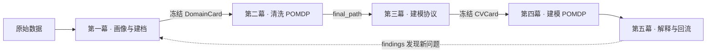

# 研究流（Research Flow）——从数据到模型的一局

> 阅读说明：**U = 用户**（领域科学家），**A = agent**（mflowy 的策略 π——环境面在引擎，决策权在你眼前的这段对话里）。工具调用以行内代码标注；`[thinking]` 是 agent 在工具调用之间的决策思考——π 的选择步骤；「幕间」是方法论点题，可跳过。本文是**案例叙事**，能力与工具签名以 MCP `tools/list` 为真源，随版本演进。
>
> 深钻指引：决策点的成文方法论依据已拆为两份参考——清洗侧（先验/检测/处置矩阵）→ [method/data-cleaning.md](method/data-cleaning.md)，建模侧（模型矩阵/CV-HPO/特征工程/评估）→ [method/model-training.md](method/model-training.md)。本文只保留叙事与五律级锚点（见文末）。

## 科学决策总纲（五律）

对话中 agent 的每次拒绝与坚持，都来自这五条上位原则：

1. **划分先行**——测试集是一次性资源，只被最终评估触碰一次；任何由数据算出的统计量只能来自训练折。
2. **基线参照**——"好不好"是相对命题：多模型同场对比 + 领域基线，无参照系的单模型指标没有决策价值。
3. **不确定性量化**——单次评估只是一个样本；差距小于折间波动时判"无显著差异"，不强行排名。
4. **单一变更**——一次实验只改一个决策变量，其余冻结，收益才可归因。
5. **可复现**——固定种子、自动记录血缘、每步决策留日志，任何结论可被第三人重放。



三道冻结门（卡即对局规则，改卡 = 新开一局）：`DomainCard → 清洗 POMDP`、`final_path → 建模 POMDP`、`CVCard → 建模 POMDP`。任何一幕结论不成立，回退上一幕重开，而不是在当前幕硬调。

---

## 第一幕 · 画像与建档：数据为什么长这样

**U**：这是我们的酶解绿茶提取实验数据，486 行。想预测 DPPH 自由基清除率——能不能建模？

**A**：先看画像，不急着下结论。（`data_profile("dpph_extraction.csv")`）整体印象：486 行 × 12 列，目标列 `提取率_pct` 连续、右偏——回归问题的样子。但画像里有几处需要你裁决的信号：

- `乙醇浓度` 数值双峰：主体在 55–95，另有 82 行落在 0.4–0.7——像是**百分数与小数两种记法混录**；
- `温度_C` 有 13 行是 −999——典型的**哨兵值**（传感器故障的记法？）；
- `提取率_pct` 缺失 27 行，另有 3 行超过 100（118.6、104.2、121.3）——物理不可能；
- 9 行**完全重复**——双录入？；
- `溶剂类型` 有 "乙醇 / ethanol / Ethanol␣" 三个变体；
- `设备型号` 全表常量，`实验编号` 全表唯一（ID 列）。

**U**：乙醇浓度确实有两批实验，早年的师兄用小数记的。−999 是温控坏了那几天。

**A**：这正是画像回答不了的——"数据为什么长这样"只有你知道。所以下一步是建档问卷，几个必答题（`propose_questions`，证据接地出题）：

1. **目标列**是 `提取率_pct`？（是 → 任务回归）
2. `实验编号` 是 ID 列吗？（是 → 从特征剔除防泄漏；行删除允许）
3. `提取率` 的合法范围是 0–100？
4. 行删除的下限——这批实验贵吗，最多容忍删掉多少？
5. `乙醇浓度` 的单位约定：以百分数为准？

**U**：都对。行保留率不能低于 90%，每组实验都花了不少工夫。

**A**：收到。再补两步证据：围绕目标的相关性（`eda`）看信号强度——`温度`、`乙醇浓度` 与提取率的单调趋势都在，`粒径_um` 的趋势发散（先记着，第五幕它会回来）；然后 dive-in 出几个深钻问题（`propose_questions` 带上 eda 证据）——画像说 `粒径` 有双峰，是目估粒径与筛分粒径两种口径混录吗？

**U**：……很可能是。早年目估，后来买了激光粒度仪。

**A**：记入档案疑点，不阻断主线。DomainCard 冻结如下——**注意，冻结即对局规则**，之后任何动作都受它约束：

```yaml
target: 提取率_pct          # 值禁改（删行允许）
id_columns: [实验编号]       # 从特征剔除防泄漏（never_drop 只圈目标/受保护/时间列）
expected_ranges: {提取率_pct: [0, 100]}
unit_hints: {乙醇浓度: "%"}
min_row_retention: 0.9      # 过激动作会被引擎拒绝
```

### 幕间 · 双源对账

画像（证据）× 你的回答（先验）**冲突即发现**：小数浓度、−999 哨兵、粒径双峰，都是两源对出来的。问卷不是记录工具，是对账工具——疑似 ≠ 确定，所以粒径只入"疑点"，不入"规则"。

---

## 第二幕 · 清洗 POMDP：环境与策略分家

**U**：你打算怎么洗？

**A**：开局清洗会话（`clean_session_start(file, card, max_steps=15)`）。初始观测：质量分 0.47，缺陷清单——`mixed_units（乙醇浓度记法混录）、high_null（提取率 27/486）、duplicate（9 行）、outlier_numeric（温度哨兵 ×13）、range_violation（提取率 >100 ×3）、constant_col（设备型号）`。预算 15 步——**预算是硬的，回滚不退步**，好钢要用在刀刃上。

**A**：选项面**不设菜单**——候选我自己排（词表内算子按观测证据自选，排序是我的判断不是引擎的命令）：

```
① drop_duplicate（9 行）   证据: duplicate           排序依据: 双录入是泄漏源，跨折可对答案——除毒先行
② normalize_units          证据: mixed_units(乙醇浓度) + 画像的溶剂变体   排序依据: 记法统一，后续判断的前置
③ fill_median(温度)        证据: outlier_numeric(温度哨兵 ×13)  排序依据: 哨兵转缺失后中位数填充
④ drop_cols(设备型号)      证据: constant_col        排序依据: 常量列零贡献
```

**A**：[thinking] 重复行是泄漏源，证据最重——先除毒。

**A**：执行（`clean_apply`——动作 + finding_ids + reason 双必填，每步可审计）——质量 0.47 → 0.55。每步返回 reward（ΔΦ）与 diff 摘要，决策日志记下 (s, a, r, s′)；下一轮观测里已了结的缺陷退场，剩下的还是记法、温度、常量三件。

**A**：[thinking] 记法混录证据最重，且是后续浓度判断的前置——记法不统一，离群无从谈起。

**A**：执行——溶剂变体归并、浓度小数行 ×100 对齐，0.55 → 0.68。再观测时缺陷清单多了一张**新面孔**：

```
① fill_median(温度)              证据: outlier_numeric(温度哨兵 ×13)  排序依据: 哨兵转缺失后中位数填充
② drop_outlier_iqr(乙醇浓度)     证据: outlier_numeric(浓度 ×3)        排序依据: 记法统一后新暴露的高浓离群
③ drop_cols(设备型号)            证据: constant_col                   排序依据: 常量列零贡献
```

变换会掀出新的缺陷层——浓度双峰并轨之前，这 3 个离群藏在两种记法的缝里。**观测是活的**。

**U**：等等，那 27 行缺失的提取率，你直接用均值填上呗？别删行，我心疼数据。

**A**：填不了——`clean_apply(fill_median, {cols: [提取率_pct]})` 被守卫拒绝：**"动作修改了目标列的值（填充/截断禁止；行删除允许）"**。目标列是监督信号之源，填它等于用模型教模型。替代走法是删这 27 行：保留率 486→459 = 0.945，高于你的 0.9 下限，放行。（若低于下限，引擎也会拒——"动作过激"，那时我们得回头谈卡。）0.68 → 0.78。

**U**：那 3 行提取率 118% 呢？

**A**：`expected_ranges` 已经圈住它们（违例直接进缺陷清单与观测面）。试探删行就真提交——失败即免费异常，负 reward 即回滚，全量真值决策。0.78 → 0.83。

**U**：温度那 13 个 −999，直接删了？

**A**：删 13 行太奢侈。恢复循环——[thinking] 证据最重的是温度填充，但我先摘第二行：浓度离群不除，填充与缩放的判断都会混进噪音。**观测给证据，顺序我做主。** 0.83 → 0.86。然后温度哨兵转缺失、中位数填充——温度与提取率的关系是渐变的，13/459 的填充不伤分布。0.86 → 0.88。

**A**：观测里只剩常量列和边际缺陷了：执行常量列 +0.004，再试一步 +0.005——**平台期**。继续刷分大概率是过度清洗：数据不是越干净越好，是为建模而干净（实证依据见 [data-cleaning.md](method/data-cleaning.md) §3.4）。收局前先 `clean_finish(preview=true)` 只读探一眼 skill——零副作用；收局（`clean_finish`）：

- 终态质量 **0.89**；
- **终局 U**：train-fold 快速学习器验证，skill = 0.84——"干净且可学"（若 skill ≤ 0，说明我删过头把信号删没了，此时应该回滚而不是收局——这是"干净但不可学"的警戒线）；
- 交付物：`final_path`（终态 parquet）+ `plan_yaml`（八步清洗计划，可入 DAG 全量重放对账）+ 全程决策日志。

**U**：如果我中途反悔某个动作呢？

**A**：每步一个 parquet 版本快照，`clean_rollback(to_version)` 可回退任意历史版本——预算不退，但坏动作可撤销。审计面上，决策日志不可篡改。

### 幕间 · 每步可审计

清洗 POMDP 的分工：**环境面在引擎**（转移、守卫、预算、观测），**策略在 agent**（选哪个动作、何时回滚、何时收局）。守卫拦的是"事实不成立"（删了目标/受保护/时间列、改了目标值、保留率破线），从不拦"你觉得该怎么洗"——你的领域判断经参数注入，引擎的物理约束经守卫强制。

---

## 第三幕 · 建模协议：开局前把规则谈定

**A**：进建模前，四问（`model-brief` 剧本，规则预填、你只确认）：

1. **目标**：这个模型拿来干什么？
2. **指标**：默认按任务选 R²/MAE，有偏好吗？
3. **约束**：要可解释吗？有禁用的模型族吗？
4. **外部基线**：文献或经验公式给过参照数吗？

**U**：目标是**替代三分之二的验证实验**——模型筛掉没希望的工艺组合，只做 promising 的。要可解释，组会要向导师解释每个结论。数据不到 500 行，神经网络就别上了。实验室有个经验公式，R² 大概 0.6。

**A**：协议冻结——`modeling_session_start` 以 cv_card（`cv: 5\ntest_size: 0.2` 的 split 配置明文）+ 显式协议参数开局：`task=regression, metric=r2, candidates=[{XGB: baseline 锚定}, {LGBM}, {CAT}, {RF}]`（MLP 出局——你的「神经网络就别上了」），`max_steps=8, external_baseline={value: 0.6, metric: r2, source_text: 实验室经验公式, source: internal_history}`（建模域先验，四件套结构化）。开局即四门校验：task↔目标 dtype、metric↔task、cv↔数据规模、预算与候选——任何一门不过，fail-loud，现在改比开局后改便宜。**test 集在这一刻已被切出、封存**——此后它只被 `final_train_test` 触碰一次（律一）。

---

## 第四幕 · 建模 POMDP：从基线到终局

**A**：开局后先读决策面（`modeling_observe`）——预算 8 个实验数、候选族超参面、光标就位。**选项面不设菜单**：八动作面 = `select_model / set_hp / set_hp_space / set_seed / select_FE`（配置编辑，零步费）+ `run_hpo / final_train_test`（计算动作，吃步）。基线段——逐族 `select_model` 定光标 → `run_hpo`（Optuna 增量搜索，inner-CV 出证，全程不碰 test）：

```
board（inner CV，均值−std）:
  LGBM  0.72    XGB 0.71    CAT 0.70    RF 0.69
```

**U**：LGBM 赢了？就它了。

**A**：还不到下结论的时候——0.72 vs 0.71 的差距小于折间波动，按无显著差异处理（律三）。进结构搜索段：账本已记下 LGBM 的 θ* 与 u_inner，接下来一次只动一个槽位（律四）。可动的配置编辑（零步费零奖励，生效于下一次 `run_hpo`）：FE 槽、超参空间槽、seed 槽。

**A**：[thinking] 先动 FE 槽——`select_FE(ordinal_encoder)`：溶剂类型三类有序（极性序，水 < 乙醇 < 甲醇是你给的领域知识），默认编码丢了序信息。`run_hpo` 一跑——LGBM 0.72 → 0.74，账本添一行。

**A**：[thinking] 再动 FE 槽——`select_FE(robust_scaler)`：浓度列有极端值残影，standard 会被拖偏。0.745。两轮增益 +0.02 → +0.005，递减到平台。配置编辑不吃预算，但每次 `run_hpo` 吃一个实验——预期收益已不抵，**收束，准备过门**。

**U**：那现在让 LGBM 全量训练？

**A**：这是**单向门**（`final_train_test`）：先搜后店——获胜结构全量终训 + **test 集在此被唯一一次触碰**，combo 随即冻结（回退被结构性拒绝，律一的硬边界；此前 `run_hpo` 全程 no-peeking）。门很贵，过门前我把牌面亮给你：inner 证据 0.745，外部基线 0.6，过门预期显著超越基线。过吗？

**U**：过。

**A**：`final_train_test` → **holdout R² = 0.76**，MAE 3.1（百分单位）。收局剧本三步走完再收编：泰勒图对比误差结构（`draw_taylor_diagram`，多终训 run 才有对比面）→ 报告素材（`modeling_report_skeleton`——表格数字抄账本，叙事归我写）→ 报告落盘后 `modeling_finish(pdf)` 收局，交付：

- **holdout R² = 0.76**，MAE 3.1（百分单位）；
- 对照系：经验公式 0.60 → **模型 +0.16**；四个族同场排名，LGBM 胜出可归因（同折同种子，律二/律四）；
- findings 三项体检：无过拟合信号（inner−holdout 差 5%）；无切片塌陷；**`粒径_um` 误差集中（|ρ|=0.41）**——模型的误差系统性地堆在这一列上；
- 交付物：模型 loader（mlflow run 内，`predict`/`explanation` 直接消费）+ modeling_steps（可重放计划）+ 终局报告（pdf，finish 收编）+ findings。

### 幕间 · test 是一次性资源

整个建模 POMDP 的形状由一件事决定：**holdout 只读一次**。过程证据全部来自 inner-CV（可恢复侧——错了下一步实验修正、光标可回弹）；终局读数只在 `final_train_test` 出现。这就是为什么结构搜索段可以试错、终局段不可回头。

---

## 第五幕 · 解释与回流：故事没有终点

**A**：解释胜者（`explanation`，SHAP）：

- `温度` 单调推高提取率——符合 Arrhenius 直觉，方向可信；
- `乙醇浓度` 呈**峰形**（60–70% 处贡献最高）——与文献的极性匹配效应一致；
- `粒径` 贡献不小但方向发散——结合第四幕 findings 的误差集中，两处证据指向同一件事。

**U**：所以粒径那列真的有问题。

**A**：第一幕的档案疑点在这里兑现了：目估与激光粒度仪两种口径混录，模型的误差踩在这条缝上。findings 的建议是**回流清洗域**——统一粒径口径（或补记口径来源列）后重开清洗会话。这正是总图上那条从"解释"折回"建档"的虚线：**评估与解释发现新问题 → 回第一幕**，而不是在当前模型上硬调。

**U**：那这次就先到这里？

**A**：本次交付清单——

| 交付物 | 位置 | 用途 |
| --- | --- | --- |
| 终态数据 | `final_path`（parquet） | 建模数据源 / 下轮回流的输入 |
| 清洗计划 | `plan_yaml` | 可入 DAG 全量重放，审计"计划 ≡ 终态" |
| 模型 | mlflow run（loader） | `predict` / `explanation` / `inverse_optimization` 直接消费 |
| 体检报告 | findings ×3 | 过拟合 / 切片 / 误差集中（回流线索） |
| 决策日志 | 清洗 + 建模两本 | 全程 (s,a,r,s′)，任何结论可被第三人重放（律五） |

下次回流时：改卡（粒径口径入 `unit_hints` 或新增口径列）= 新开一局，历史日志仍在，审计链不断。

---

## 术语表

对话中术语的集中锚点（按出场序）；方法论主张见五律，文献依据见文末锚点。

| 术语 | 含义 |
| --- | --- |
| 建档卡（DomainCard） | 数据领域先验的冻结档案：目标列 / ID 列 / 合法值域 / 单位约定 / 保留率下限——开局即冻结，改卡 = 新开一局 |
| 协议卡（CVCard） | 建模对局规则的冻结档案：任务 / 指标 / CV / 预算 / 结构化候选（baseline 锚点 + space_hints + seed）/ 外部基线——开局即四门校验 |
| 画像 | 逐列统计摘要（dtype / 缺失 / 唯一值 / 偏度 / 高频值），`data_profile` 产出 |
| 哨兵值 | 用特殊常量（−999/9999）表示缺失或异常的记法，须转缺失再处理 |
| 双源对账 | 先验（用户回答）× 证据（画像/检测）冲突即发现的建档方法——疑似 ≠ 确定 |
| 缺陷清单 / 质量分 | 清洗会话的观测面：错误类型 × 计数，与内生质量分 Φ（规则加权） |
| 选项面 | 不设菜单：可执行动作 = 词表全集 / 八动作面，agent 按观测证据**自构** apply（清洗提交面双必填 finding_ids + reason）——排序是 π 的判断，不是引擎的命令 |
| 免费失败 | 动作在 commit 点前失败即免费异常：不耗预算、不落版本、不进决策日志——试探面 = 提交后读 s′，负 reward 即 rollback |
| 守卫 | 引擎侧硬约束：never_drop 列存活、目标列值禁改（删行允许）、保留率下限——拦"事实不成立"，不拦判断 |
| 回滚 | 版本树回退到任意历史版本；预算不回补，决策日志保留（审计不可篡改） |
| 平台期 | 连续多步质量增益 ≈ 0 的信号——继续清洗大概率过度 |
| 终局 U / skill | 终态数据上 train-fold 快速学习器的相对基线提升；skill ≤ 0 = "干净但不可学"警戒线 → 回滚而非收局 |
| 清洗计划（plan_yaml） | 会话决策日志的可执行形态，可入 DAG 全量重放对账（审计/重放工件，非交接必需品） |
| board | 建模会话的记分板：结构 × inner-CV 分数（均值−std），过程证据的居所 |
| 光标 / 账本 | 建模会话的两件状态：光标 = 当前候选配置（族/超参空间/FE/seed——配置编辑零步费，生效于下次 run_hpo）；账本 = 已评估 combo 的 inner 证据（θ*/u_inner，永不回退） |
| 折间波动 | CV 折间指标的离散度；模型间差距小于它时判"无显著差异" |
| 单向门（final_train_test） | 先搜后店的全量终训 + **test 集唯一一次触碰**；门后 combo 冻结、不可回退（no-peeking 的硬边界） |
| findings | 建模收局的三项体检：过拟合信号 / 切片塌陷 / 误差集中列（回流线索） |
| 回流 | 解释与评估发现数据问题 → 回清洗域改卡重开一局的循环——故事没有终点 |

---

## 文献锚点（五律级）

五条上位原则的文献依据；决策点级的深度锚点（CleanML、SHAP、TabPFN、MICE 等，每条带核验级别与更正记录）随主题分居 [method/data-cleaning.md](method/data-cleaning.md) 与 [method/model-training.md](method/model-training.md)——本表条目的全文题录与核验级别见两文锚点一览（同名条目），不在此双份维护。

| 五律 | 依据 |
| --- | --- |
| 律一 划分先行（test 一次性、预处理折内、泄漏分类学） | Kaufman et al., ACM TKDD 2012；Kapoor & Narayanan, *Patterns* 2023 |
| 律二 基线参照（表格数据树族 vs DL 同场对比、无免费午餐） | Grinsztajn et al., NeurIPS D&B 2022；Wolpert & Macready, IEEE TEC 1997 |
| 律三 不确定性量化（K 折方差无无偏估计、修正配对 t） | Bengio & Grandvalet, JMLR 2004；Nadeau & Bengio, ML 2003 |
| 律四 单一变更（公平对比协议——选择偏差下的可归因性） | Cawley & Talbot, JMLR 2010 |
| 律五 可复现（就绪清单化检查、泄漏→复现危机） | Breck et al., IEEE BigData 2017；Kapoor & Narayanan, *Patterns* 2023 |
