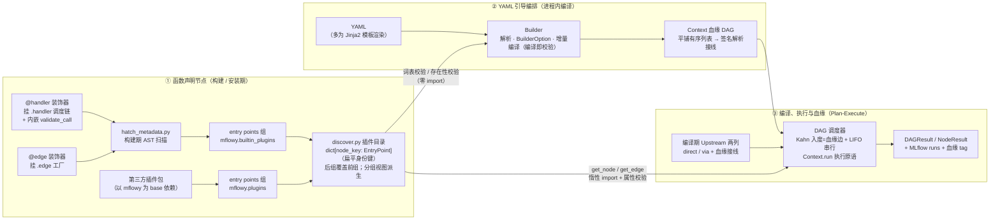
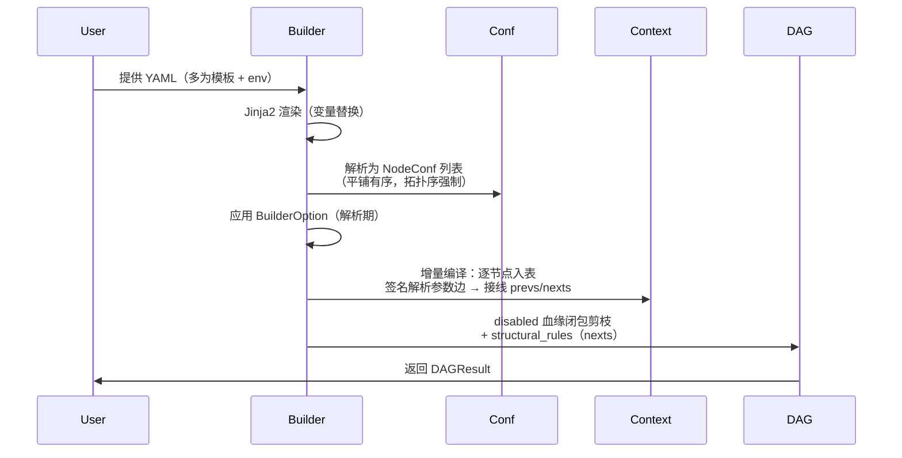

# mflowy-driver — 插件化 DAG 内核

**一个轻量的、能力全部以插件存在的、由 YAML 编排的 DAG 编译与调度内核。**

职责一句话：构建期把 YAML 图（多为模板或 LLM 生成）编译成 Context DAG，运行期串行调度插件目录中的 handler——计算发生在插件内，内核只组合与调度，并把每次运行装配成可追溯的实验记录（DAGResult + MLflow runs）。远程执行由 JobProvider（mcp 包）把整个工具抬到远端，driver 本体始终进程内。

本内核由三件制品构成，本文即按此组织：

1. **[函数声明节点](#函数声明节点)**——能力以 `@handler` pyfunc 声明、变换以 `@edge` 边函数声明，身份是 entry point name，安装即注册；
2. **[YAML 引导编排](#yaml-引导编排)**——组合是数据不是代码：Builder 把 YAML 树（含 Jinja2 模板、options 改写）编译成 DAG；
3. **[编译、执行与血缘](#编译执行与血缘plan-execute)**——编译即校验：数据边按名字三层解析（边 > 组名索引 > node_key 索引）在增量编译中产出血缘图，执行消费编译产物，血缘是运行期实录。

> 事实以代码为准，本文只沉淀心智模型、设计意图与赌注。`mflowy/driver/` 即本包。

## 定位与边界

四个目标词各自排除了一类方案：

| 目标 | 排除项 |
|------|--------|
| 轻量 | 事件总线、生命周期状态机、反射式依赖注入、热重载 |
| 插件自主注册 | 手工登记表、中心化 wiring、为注册写配置/CLI |
| YAML 编排 | Python 代码编排、图 DSL、GUI 建图 |
| DAG 执行 | 通用插件框架、长驻服务运行时、动态装卸 |

**非目标**（范围选择，非缺陷）：并行执行——调度器（`dag.py` Kahn 入度 + LIFO 就绪栈）刻意串行。

## 设计哲学：内核冻结，生态外挂

一句话：**内核只做编译与仲裁，能力是插件、身份是声明、安装即注册；图是从能力目录组装出的一等工件。**

谱系：本设计与 cordis、pi、dsh 等以插件为核心的架构一脉相承——封闭内核 + 声明式注册（安装即注册，无注册中心）+ 目录与解析分离 + 版本化 SDK 让生态自行生长。pi 的 extension/skill 生态（包安装后自动进入工具目录）是这一模式最直接的参照；mflowy 把同样的赌注押在 ML 工作流上：**能力目录由包管理器维护，内核只消费目录**。

| 命题 | 内容 | 换来的东西 |
|------|------|-----------|
| 1. 内核冻结，能力皆插件 | 内核不实现任何业务能力（内置能力也在独立包——`packages/builtin_plugins/` 的 mflowy-data / mflowy-model，entry points 组 `mflowy.builtin_plugins`，与第三方同构）；定制全部走构建期变换（BuilderOption、Jinja2 渲染），调度内核保持纯调度 | 内核可独立测试、独立演进；内置能力即第三方插件的活参考实现（持续吃狗粮） |
| 2. 身份即声明 | 节点地址是 entry point name `namespace.node_name`，不是函数名或全局 ID；声明住在包元数据（pyproject），不住在代码 | 词表可枚举、可校验、可审计、可被外部扩展；LLM 与人共享同一图语言 |
| 3. 安装即注册 | uv/pip 装上即进入目录，卸载即退出；无 register CLI、无本地状态文件 | 环境可复现（K8s Job 容器与本地天然一致），插件分发零额外机制 |
| 4. 目录与解析分离 | 目录查询（`discover`/`list_all`/`entry`）纯元数据零 import，且现算（无 `@cache`——新装插件与外部 reload 即时可见）；import 惰性发生在 `get_node`/`get_edge`，以 `.handler`/`.edge` 属性校验声明一致性 | 缺依赖的模块照常列出（而非静默消失）；坏声明（忘标装饰器、value 路径写错）fail-loud |
| 5. 边名字三层寻址 | 参数边解析：**边名（`@edge` 变换，仅 `edges` ns）> 组名 > 节点名**，零命中构建期 fail-raise；命中后做输入/输出注解一致性检查（编译期类型校验，非寻址——返回注解不参与寻址）；类型适配经 `@edge` 边函数显式化（`a-\|edge1\|->b`） | 换 module 不改下游连线（组寻址，XGB→LGBM 只改一行）；类型适配是可复用词表项而非隐藏中间件；解析全静态——mermaid / nodes+edges JSON 构建期即出图 |
| 6. 图住配置，代码住目录 | 能力（目录项）与图（YAML 工件）分离，派生两类角色：能力作者添目录项，图组装者（人、模板、LLM）拼 YAML | 两类演化互不阻塞，driver 本质是两个角色之间的编译器 |
| 7. DAG 是实验计划书 | 串行调度、无增量跳过：每次运行必留痕，复用旧结果是显式 `run_id` 引用而非静默缓存；观测（mlflow 尾链）织入内核 | agent 的控制流永远可预测；实验即记录 |

命题 1/6/7 合称"编译器前端"：全部组合发生在执行前，运行期只剩纯调度。

## 架构总览



- **①** 只发生在构建/安装时刻：能力作者写 pyfunc + `@handler`（节点）或 `@edge`（边函数），构建期 hook 扫描生成 entry points，身份随包元数据分发；目录查询现算（热更新——与 ③ 的计划快照是两层：目录随时可见，计划定格于所属 DAG 实例）。
- **②** 是进程内编译：Builder 按 YAML 序增量编译——词表校验（零 import）、签名对节点表解析参数边、接线双向邻接表；**编译即校验**（拓扑序/撞名/类型门 fail-loud，`valid` 门已退役）。
- **③** 是进程内执行：静态解析产出计划（`ctx.resolve()`），调度期按节点惰性加载并校验，绑定/拉起/血缘全部发生在这一层。
- **覆盖语义**：`mflowy.plugins` 组按声明覆盖 `mflowy.builtin_plugins` 同名项（info 级日志），同组撞名 warning——定制内置行为不需 fork；跨层撞名（边名撞节点/组名）warning（边优先会改写既有绑定）。

## 一次执行的生命周期



| 阶段 | 代码 | 说明 |
|------|------|------|
| 模板渲染 | `builder.py: _load_yaml` | `{{ var }}` 注入 `env` 参数；生产入口多为模板而非手写 YAML（见「模板与片段组合」） |
| 配置解析 | `config.parse_flow_item` | 单键映射列表 → NodeConf 元组（平铺；嵌套键/缺 node_name/stop_on_error fail-loud）；params 保持原始 dict（类型解析/校验在调用期，见 @handler） |
| 配置变换 | `builder.py: _transform` | `BuilderOption` 逐节点应用（构造期，声明序） |
| 增量编译 | `builder.py: _compile + NodeTable` | 逐节点入表（组名保序 / node_key 双索引）、签名解析参数边（词表 miss/M1 撞名/必选边不可达/类型门 fail-loud）、接线 prevs/nexts |
| 配置剪枝 | `builder.py: _prune_disabled + _apply_structural_rules` | disabled 血缘闭包（本体+传递后代出局）+ `structural_rules`（看血缘 nexts，无消费者即剪） |
| 调度执行 | `dag.py: _next` + `context.py: run` | 见下 |

运行期语义：

- **Kahn 入度 + LIFO 就绪栈**：深度优先，刚解锁的下游先跑、独立分支按声明逆序。总时间不变（串行求和），但下游结果更早产出。
- **双入口，同一执行原语**：`DAG` 是 Kahn 调度器（push 全图），`Context.run()` 是单节点执行原语（自带 NodeResult 记账）；**单独 run 任一未执行节点即按需子图入口**——其绑定期惰性拉起全部未执行前驱（详见「解析、执行与血缘」）。
- **通道边界**：节点 `print`（stdout）被 `capture_prints` 捕获进 `NodeResult.output`（ContextVar 路由，线程/请求间互不干扰），`logger`（stderr）走过程诊断；回显是入口层职责（DAG / 直接调用方）。
- **失败语义（#59 血缘剪枝）**：节点异常 = 剪掉其血缘后代闭包、其余路径继续（`stop_on_error` 已退役，一切异常一视同仁）；失败节点以 `repr(e)` 记账进 runs、被剪节点计入 runs 且 `status="skipped"`（无 run）；`DAGResult.status`：finished / partial（有失败且有完成）/ failed（全灭），`error` 全量聚合、定位到图键 `[namespace.node_name.node_N]`。
- **结果结构**：实验名/ID + 逐节点 run_id/状态/输出 + graph（mermaid DAG 视图，节点按调度序、**数据边带标签**：直连 `a --> b`，经边函数 `a -->|edge1| b`；`to_graph()` 另出 nodes+edges JSON）。

## 函数声明节点

### 自主注册（最核心的设计）

新插件 = 一个 pyfunc + 一行装饰器，四处自动生效：

```python
@handler(namespace="clean")   # 能力作者只写这几行（归组声明即身份）
def common_filter(...) -> pd.DataFrame: ...
```

1. **身份声明**：包构建期 `hatch_metadata.py` AST 扫描 `@handler` / `@edge` 函数生成 `[project.entry-points."mflowy.builtin_plugins"]`——name 即身份（节点 `namespace.node_name`，归组由装饰器 `namespace=` 声明；边函数注册于 `edges` ns；纯 AST 零 import，构建环境无 torch 也能构建）
2. **能力标记**：`handler.py: @handler` 内嵌 `validate_call`（签名即约束：`Annotated[T, "描述"]` 兼容旧约定、`Field(...)` 带约束、裸类型注入参数 is-instance 直通），织入中间件链后把 `.handler`（调度链，`__wrapped__` 回指原函数供内省）挂到函数属性上；`mlflow_log` 强制尾链（`builtin_middleware.py`——stop_on_error 已随 #59 血缘剪枝退役），每个 handler 必在 mlflow run 内执行
3. **目录与解析**：`discover.py` 按序读两组 entry points（`mflowy.builtin_plugins` 内置 + `mflowy.plugins` 第三方），`discover()/list_all()/entry()` 纯元数据零 import；`get_node`/`get_edge` 惰性 import 并以 `.handler`/`.edge` 属性校验声明一致性，坏声明 fail-loud
4. **用户文档**：`module.py: get_node_info` 内省 `Annotated[T, "描述"]` → JSON Schema（纯用户可配参数），参数边依赖经 `NodeInfo.upstream`（展平边函数的节点名，保序去重）独立下发——MCP schema 即 API 文档

**editable 陷阱**：entry points 元数据在 `uv sync` 时生成，新增插件模块后必须重跑 `uv sync` 才会出现在 `list-nodes`。

### 类型注解单源

`Annotated[T, "描述"]`（旧式字符串，兼容）与 `Annotated[T, Field(description=..., gt=...)]`（带约束）是全引擎的契约单一事实源：`@handler` 内嵌的 `validate_call` 在调用期解析/校验、`get_node_info` 直出 JSON Schema 文档——两者同一套 pydantic schema 机器，文档与校验永不漂移。签名约定：裸类型参数 = 参数边（is-instance 直通，收集形态需注迭代器），`Annotated` 参数 = 用户可配（文档据此过滤）；**`Annotated` 只用于参数，返回值保持裸注解**（返回注解参与构建期一致性校验与文档，不参与寻址；误写 `Annotated` 会在文档中产出幽灵参数，责任在插件作者）。**默认值的单一事实源是函数签名**——空可选边直接省略参数，默认值由 Python 调用期原生生效；Field 只带约束与描述。

builtin 词汇的类型转换知识挂在类型上（词汇主人）：`DiscreteSpace.__get_pydantic_core_schema__`（yaml list → 实例）、`DualFormStrEnum`（枚举值/名双形式）；stdlib dataclass（如 `ContinuousSpace`）的 dict→实例 pydantic 原生支持。第三方数据结构的 YAML 值转换同样挂 `__get_pydantic_core_schema__` 钩子。

### 中间件链（单平面）与 @edge 数据边

注册时一次性织入：`@handler(mw1, mw2)` → `mlflow_log → mw2 → mw1 → handler`。中间件全部为**遥测面**（log_* 领域日志，活跃 mlflow run 窗口内执行）；**数据面已参数边化**——绑定在链启动前完成（本节点 run 窗口外），取值闭包惰性拉起上游不撞同线程活跃 run。

数据变换不再是中间件：**`@edge` 边函数**（`driver/edge.py`）是具名词表项——

- 拓扑记法 `a-|edge1|->b`：`@edge def edge1(a: A) -> Edge1` + `b(edge1: Edge1, ...)`；边无图位置，组装在 builder 编译期——边函数自身参数对节点表解析（晚绑定=声明序：同边在不同位置各自绑其声明序上游，单值取末位）
- **恒单值指边返回**：边函数返回值单值注入消费方同名参数（返回注解应与消费方参数注解一致，构建期校验）；边函数自身参数遵循与 handler 参数相同的注解规则——收集形态（`Iterator[X]`）合法，用于聚合多上游
- 边不进调度记账（无中间件/run/NodeResult），血缘对边透明（记上游节点）；参数只解析组/节点两层（**不吃边**——边链成环无从发生，YAML 嵌套无环性覆盖全部解析递归；跨边复用走函数体内直调）
- 解析优先级：**边名（仅 `edges` ns）> 组名 > 节点名**，零命中构建期 fail-raise（报错路径 `edge1.a`）；消解命中后做输入注解 vs 上游/边返回注解的一致性检查（相等性比对，任一侧未注解即放行）

中间件两处：内核默认尾链 `driver/builtin_middleware.py`（装饰器编译期依赖）；插件侧 `mflowy/builtin_plugins/middlewares/`（`log_*` 遥测）。

## YAML 引导编排

### 平铺键控有序列表（#59 叙事重构）

YAML = **单键映射有序列表**——列表项即 ``{node_key: 配置体}``（键即身份，与词表投影
NodeEntry.name 同构）：

```yaml
flow:
  - load__file:
      name: 导入
      params: {file_path: data.csv}
  - x_y:
      name: 拆分
      params: {targets: target}
  - model__XGB:
      name: 训练
  - model__MLP:
      name: 备选
      disabled: true
```

无嵌套、无 `branches`、无 `placeholder`（已退役）；**拓扑序强制**（前向引用 fail-loud）；
边完全由签名机器对节点表解析（YAML 零边声明）。并行性是血缘的派生物：互不消费的节点
天然并行（执行仍串行，见非目标）；n-1 汇聚 = 收集形态参数全收同组多实例。

- **`disabled: true` 剪枝** = 编译期**必选依赖闭包**：disabled 节点出局，其必选消费者（single 末位者出局 / collect 全员出局）连锁出局；**可选依赖不传导**——幸存者剥除该绑定后经 MISSING 落回签名默认值（"disabled = 图中不存在"语义），collect 部分出局只收幸存成员。disabled 节点同样全解析（停用即"完整图的配置"，随时可开——悬空参数编译期如实暴露，不留陈账）。
- **词表校验 fail-loud**：未知 `namespace.node_name` 编译期对目录校验（零 import），报错附 available 列表。

### 模板与片段组合

生产入口几乎不是手写 YAML，而是 **Jinja2 模板（`builtin_plugins/model` 的 `templates/`）+ `env` 注入**。片段可再加工后跨工具复用：`explanation` 工具复用 `modeling` 的 `modeling_steps_yaml` 片段——Builder 解析 → `prune_model_step` 改写（model 步替换为 loader）→ `serializer.flow_to_yaml` 重新序列化 → 注入另一张模板。`serializer.py: _plain`（Enum→名、dataclass→dict）与参数转换器构成 **YAML 往返闭环**，配置因此是可生成、可改写、可再注入的一等公民。

### 双钩子：BuilderOption 与 StructuralRule

内核的两个定制注入点，**同形不同相**——都是"接收当前态、返回变换后对象"的纯函数，
区别只在生效相位决定的信息视野：

| | BuilderOption | StructuralRule |
|---|---|---|
| 生效相位 | 编译**前**（解析期，图未成形） | 编译**后**（血缘图已织入） |
| 签名 | `NodeConf → NodeConf` | `Context → Context \| None` |
| 信息视野 | 只知节点自身（conf） | 上下游血缘全知（`ctx.nexts`/`ctx.prevs` 只读视图） |
| 剪枝 | 不剪（只改写） | 返回 `None` = 剪枝，沿必选边连带传播 |

- **BuilderOption 工厂期与闭包期分离**：`prune_model_step` / `resume_model_step` 创建 option 时一次性完成 model 参数解析 + MLflow 查询，返回的闭包只做查表改写——应用期无外部调用（`prune` 未命中即剪枝、`resume` 未命中保持原状——覆盖"复用旧实验"的两种形态）。
- **StructuralRule 从叶子反向 BFS 生效**：消费者恒先于生产者被裁定，剪即摘除——上游随后看到幸存者视图（孤儿规则对上游二次生效）；规则剪除沿必选边连带传播（与 disabled 同策略，构建期 warning 点名连带清单），可选消费者走签名默认值。**必须返回同一 ctx**（图身份编译期织入，替换即 fail-loud）。活参考：`prune_x_transformer_step`（无 model 消费者的 FE 步即剪）。
- **只编译不运行**：`builder.build()` 不调 `run()`，validate 类工具借此做编译检查（模块存在性校验 + mermaid 预览）。

## 编译、执行与血缘（Plan-Execute）

### Context = 数据节点（注意命名）

`Context` **不是**依赖注入意义上的"环境容器"——它是 DAG 任务节点：持有 `conf`、`result`、双向依赖边（`_prevs` 溯源 / `_nexts` 调度）。

数据依赖经参数边声明：编译期按名字三层（边 > 组名索引 > node_key 索引）查节点表（`builder.py: NodeTable` 双索引，组名保 YAML 序），收集形态保序取全、单值取末位命中，`@edge` 变换的组装在同一编译里完成（`tuple[list[Upstream], list[Upstream]]`——direct 与 via 两列）。**结构=血缘**（#59）：prevs/nexts 即真实数据边，图物化不再需要 enriched 补全。

### Plan-Execute 分层：计划 / 校验 / 执行

数据库引擎的经典分工在 driver 的对应物——`dry_run` 旗标已从 DAG 执行的一切签名退役（会话 GC 的 `dry_run` 是 IO 安全缺省——只列不删，不属执行排练，不在此列），dry 不是执行的排练模式，是解析核心的另一个消费者：

| 引擎 | driver 对应物 |
|------|---------------|
| parse | Builder 解析 YAML → NodeConf 平铺列表 |
| **plan** | `builder.py: _compile` 增量编译——节点表解析 + 血缘接线（编译即校验，`valid` 门已退役） |
| **EXPLAIN** | `to_graph()`/`__repr__`（构建期即出真图——mermaid 带标签边 / nodes+edges JSON） |
| **execute** | `run()`/调度器——消费编译产物（direct 列取值闭包：拉起、值级复核、整形） |
| **EXPLAIN ANALYZE** | 血缘 tag（`_prevs` 派生声明集）↔ 静态边表对账——不等即失败 run |

- **解析核心是纯函数**（`resolve_upstream` + 模块层谓词/整形）：零副作用；dry 消费者只读检查，wet 消费者拉起 + 值级复核（撒谎 fail-loud，三处对称：节点输出 / 收集成员 / 边返回——声明查构建期 `verify_output_hint`，实值查运行期 `_check_value`）。
- **快照语义**：编译产物（upstreams 两列 + 接线）定格于所属 DAG 实例，run 期零目录查询；目录变了走显式重建 DAG。`ContextVar` 计数器保证并发 `Builder.build()` 编号隔离。

### 惰性拉起与按需子图执行

`ctx.run()` 是执行原语；单独 run 任一未执行节点即按需子图入口：

- **执行语义**：`Context.run` 执行完整中间件链（含 print 捕获），返回本节点 `NodeResult`（namespace.node_name/name/run_id/status/output）——pull 拉起来的节点有一等记账。
- **拉起判定在 pull 侧**：绑定期发现前驱未执行（`result is _NOT_RUN` 哨兵恒等判定）即当场 `run()`。拉起发生在自身 run 窗口之外（绑定在链启动前保证），不撞 MLflow 同线程活跃 run。
- **执行不记忆，绑定决议记忆**：重复 `run` 即重复执行（各自新的 mlflow run），与 `DAG.run` 两遍全量重跑同语义；而多个消费者拉起同一上游仍只执行一次（pull 层哨兵去重）。
- **失败与重试**：异常透传且 result 保持哨兵，再次 `run` 即重试；调度层的失败处置是剪枝（见「运行期语义」）——异常对象不再流入任何消费者。

### 血缘：_prevs 派生视图

血缘不再是运行期缓冲——`Context.lineage` 是 `_prevs`（声明消费集）的只读派生视图：`mlflow_log` 收尾 `finally` 点分串接（保序去重）写入 tag，**成功/失败 run 皆落盘**。语义：成功 run 下 tag 与实际消费恒等；失败 run 下为声明超集（push 调度先行的上游也在 `_prevs` 中），差集由失败异常文案指认（`check_value`/`validate_call` 均点名参数）——异常已携带的信息不再用一个可变缓冲去复刻。

血缘 tag：`context.py: LINEAGE_TAG_KEY = "mflowy.lineage"`（公开常量，中间件经 `adopt_run` 上报执行身份），值为声明消费的直接上游节点 run_id 的点分集合——数据血缘而非路径。

## 插件 SDK 速览（第三方作者）

30 秒首个插件（签名即完整契约——参数边 + 用户可配参数）：

```python
# ① 能力函数：裸命名参数 = 参数边（构建期静态解析），Annotated = 用户可配
from typing import Annotated

import pandas as pd
from mflowy.driver.handler import handler


@handler(namespace="clean")
def feather_aware_filter(
    load: pd.DataFrame,  # 单值参数边·组寻址：绑 load 组末位实例，直注 result 免 next()
    top_k: Annotated[int, Field(ge=1)] = 20,  # 用户可配（YAML params）——默认值单一事实源是签名
) -> pd.DataFrame:
    """对 feather 数据做过滤。"""
    ...
```

```toml
# ② pyproject.toml——entry point name 即身份（归组 `namespace.node` / 非归组裸名）
[project]
name = "mflowy-extra"
dependencies = ["mflowy>=1.0"]

[project.entry-points."mflowy.plugins"]
"clean.feather_aware_filter" = "mflowy_extra.filters:feather_aware_filter"
```

```bash
# ③ 安装即注册
uvx --from "mflowy[mcp,modeling]" --with mflowy-extra mflowy-mcp
```

- 参数边三层寻址：**边名（`@edge` 变换，注册于 `edges` ns）> 组名索引 > node_key 索引**——边名命中目录探针（`find_edge` 单次查 `edges` 桶，miss 返 None、导入失败透传）即绑变换；**组名索引优先于 node_key 索引**（表1 未命中才查表2）；零命中编译期 fail-raise（必选边）。类型不匹配的适配写 `@edge` 边函数（恒单值注入，编译期组装、声明序晚绑定），编译期做输入/输出注解一致性校验
- 注入形态由注解决定：无类型签名（无注解 / 裸 `Iterator`，默认当 Iterator）或注解提及 `Iterator`（含 `Iterator[X] | None` 可选收集边）= 收集边（全量拉起 + 声明序迭代器，for/`list()` 消费）；裸类型 `X`（含 `X | None`）= 单值边（仅拉起末位命中直注 result，签名免 `next()`）；签名默认值 = 可选边（零命中省略参数，Python 默认值调用期原生生效）。撒谎 fail-loud：声明输出与实际值不符（节点输出/收集成员/边返回三处对称）运行期即报
- 消费者以**组名**（`load`）或**节点名**（归组 `namespace__node`——`__` 连接符，如 `load__feather`；非归组裸节点名）寻址你的节点；返回注解不参与寻址（仅文档与构建期一致性校验）
- 扩展单元 = namespace + 节点 + 边函数；`get_node_info` 的 `NodeInfo.upstream` 与 `list_nodes` 节点条目 `{name=node_key, upstream}` 均下发**结构化元数据**——`UpstreamMeta` 扁平投影（`via` 标注消费途经的边、`expect` 类型渲染、`required`/`default` 可选性；`name == via` 的边自指条目过滤，边信息由 edges 词表承载）；缺 extra 降级 `upstream=None`
- 参考实现：`packages/builtin_plugins/`（mflowy-data / mflowy-model 两包；hatch 构建期扫描 `@handler` 的 `namespace=` 与 `@edge` 生成 entry points，抄走改 group 即可）
- SDK 面 = `driver/handler.py` + `driver/edge.py` 装饰器 + `driver/rule.py` 规则引擎实例（Rule/Activation/RuleEngine/open_engine 落盘） + `driver/builtin_middleware.py` 尾链 + 两域 `middlewares/` 遥测面；破坏性变更受 CHANGELOG 语义化版本约束

## 会话 SDK（MDP 契约与生命周期基座）

`mdp_session.py`——两个 MDP 会话域（clean/modeling）共用的契约类型与生命周期机制，也是第三方域作者实现**整个 MDP 环境**（而非只加节点）的扩展形态：

- **投影类型**：`Observation` / `Candidate` / `FinishVerdict` 三个 TypedDict——MDP 会话响应的 agent 可见契约，核心键为下限、域可加字段；`verify_*` 校验器是契约的牙齿（缺核心键/顶层类型不符 fail-loud；域测试以 `verify_*` 对账真实响应——生产路径零开销，牙齿长在域侧测试；浅层即止，嵌套结构域自验）
- **决策权地图**：引擎=事实（合法走法/转移/守卫/预算/信号），π=选择（选动作/回滚时机/收局时机/弃局）；守卫拦"事实不成立"不拦"程序下一步"，菜单与信号（`should_stop`）都是建议不是边界；结算可拒收且拒收后可续局
- **`MDPSessionHandle`**：会话服务面的类型锚点（无状态 sid 寻址，"具名核心 + `*args` 域尾巴"）；**`SessionStore`**：生命周期机制（目录/manifest IO、终态双键 `finished`/`abandoned`、`abandon`、`gc`），root 由域注入——driver=机制、域=策略（动作/检测/质量/守卫/版本树全部留域）
- **活参考**：mflowy-data / mflowy-model 两域的会话模块（对称于两包之于插件 SDK 的地位；#30/#31 契约合规迁移后结构等价）；回收面 = mcp 平台工具 `sessions_gc`（约定扫描 `~/.mflowy/*_sessions` + mtime TTL + dry-run 安全缺省——平台约定住 mcp，driver 对用户 home 零知识）
- SDK 面受 CHANGELOG 语义化版本约束（对齐 handler 装饰器措辞）

## 相关文档

- 能力目录与边函数契约：[mflowy-builtin_plugins README](../builtin_plugins/README.md)
- 引擎消费方（MCP 工具 / JobProvider / 遥测）：[mflowy-mcp README](../mcp/README.md)
- 仓库级导航与规约：[AGENTS.md](../../AGENTS.md)
